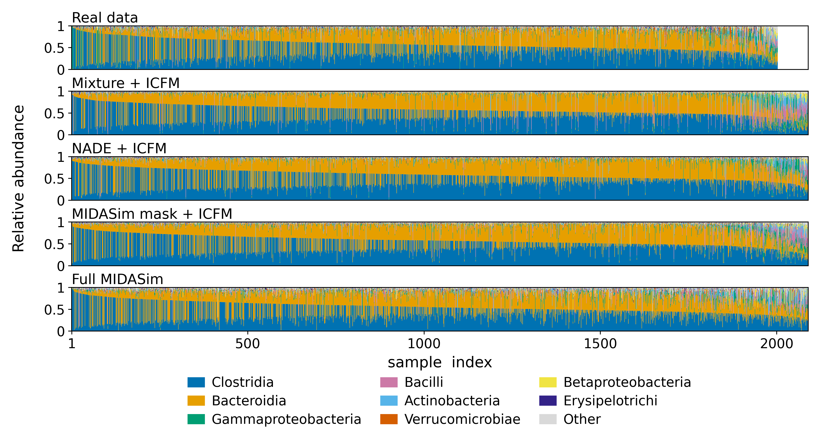
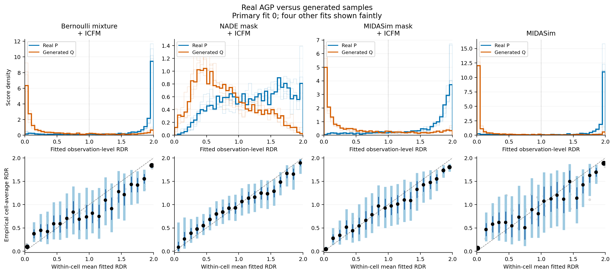
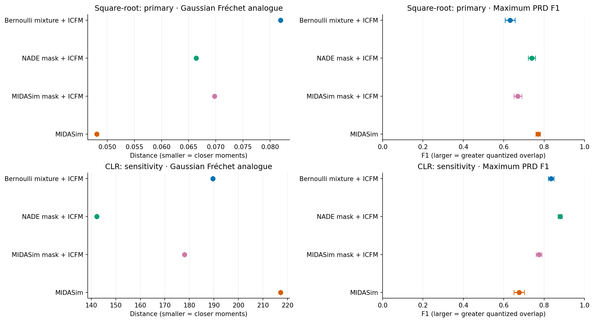
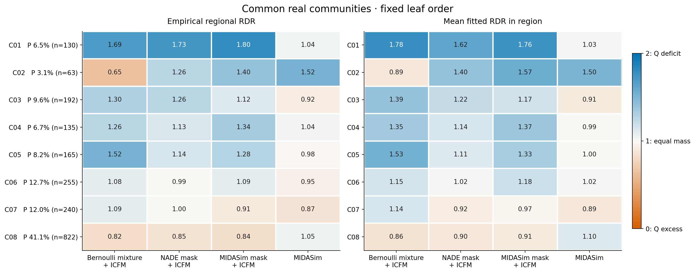
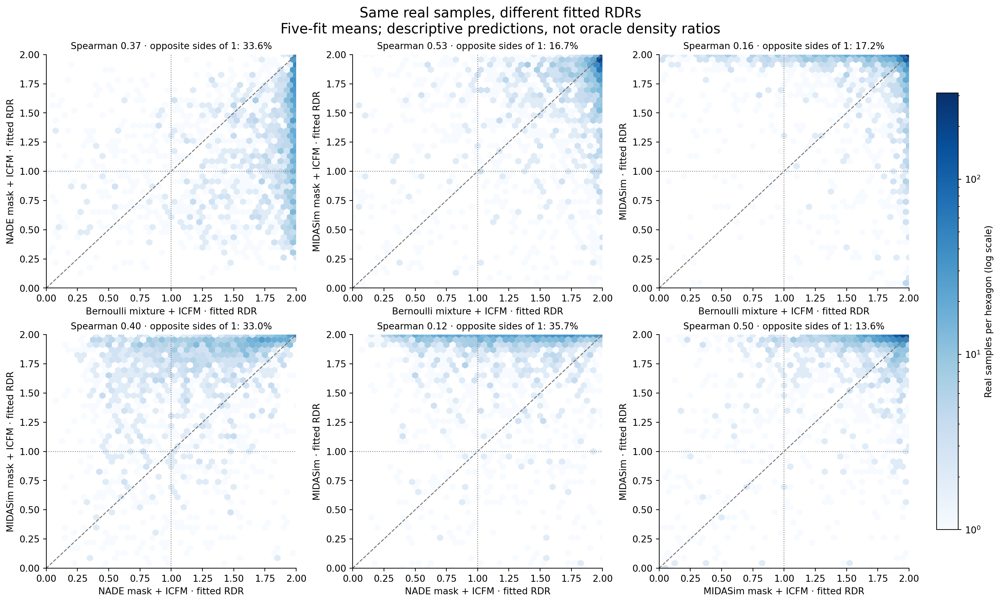
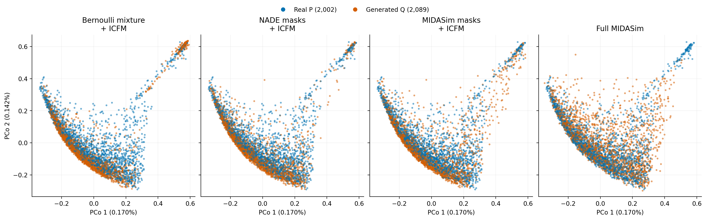
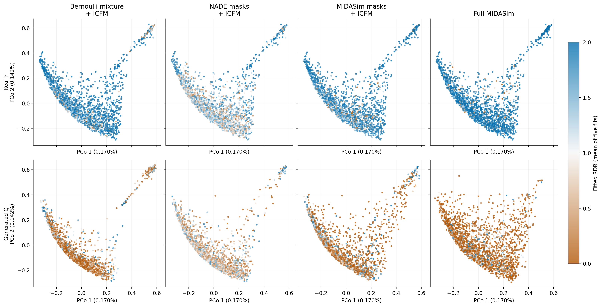
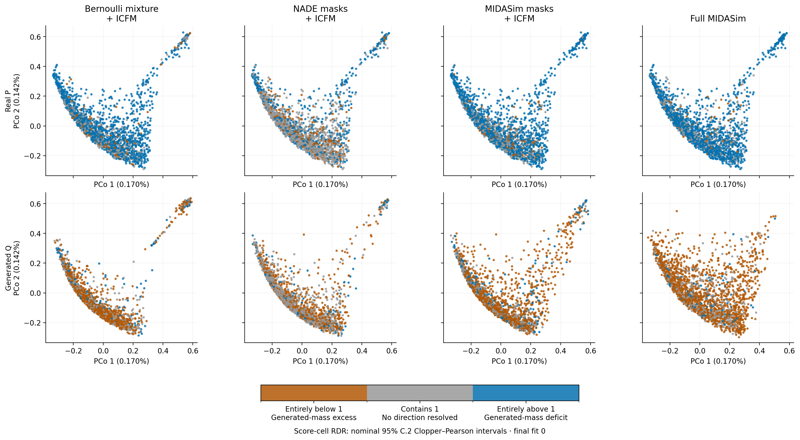

# AGP: evaluating four microbial generators with RDR and complementary metrics

This case study presents relative density ratio (RDR) as an **evaluation
method** for microbial generators. It compares four fixed generators on the
same American Gut Project assessment cohort, using global distribution
summaries, biological checks, source classifiers, and RDR diagnostics. The
main question is **where each generator underrepresents or overrepresents
real microbial compositions**, and how those local differences complement
the information in global metrics.

The evidence consists of the completed four-generator comparison, its shared
biological communities, paired real-observation scores, and assessment-only
ordination. All numerical results and figures below reuse those artifacts;
this document introduces no new fitting or assessment.

[Reproduction guide and input requirements](../experiments/AGP/README_RDR.md)

## Generators and evaluation target

| Generator | Presence patterns | Positive abundances |
| --- | --- | --- |
| Bernoulli mixture + ICFM | 32-component Bernoulli mixture | Frozen mask-conditional ICFM |
| NADE mask + ICFM | Autoregressive NADE with 256 hidden units | Same frozen mask-conditional ICFM |
| MIDASim mask + ICFM | MIDASim correlated Gaussian occurrence model | Same frozen mask-conditional ICFM |
| MIDASim | Same MIDASim occurrence masks as the hybrid | Empirical positive-abundance values arranged using correlated Gaussian ranks |

All four generate compositions on **614 taxa**, preserving exact zeros and
unit row sums. The three ICFM variants share a conditional abundance flow:
the presence model determines the mask, and the flow generates positive
abundances conditional on that mask. Full MIDASim and its ICFM hybrid share
their generated presence masks, so their occurrence summaries agree by
construction.

For real distribution P and generator Q_g, the population RDR target is

$$
r_g(x)=\frac{2p(x)}{p(x)+q_g(x)}.
$$

Values above one indicate local underrepresentation by Q_g; values below one
indicate overrepresentation. Every P-versus-Q_g pair has its own selected
evaluator. The same real observation can therefore receive different fitted
RDRs against different generators. These are estimates: the application has
no known true pointwise RDR against which to verify each prediction.

The paper contribution is signed, generator-specific diagnostic information
attached to observations and interpretable communities. The reported global
summaries do not supply those biological locations. Other regional metrics,
interpreted PRD histograms, and local realism scores can also provide local
information; the case study does not establish that localization is unique
to RDR.

## Data roles and frozen evaluator selection

Every generator is assessed against the same **2,002 real observations**,
with **2,089 generated observations per method**. Each pair has a completed
80-fit loss/slope search, five selected final initializations, and five
real–real control fits. Some completed fits are reused from earlier stages;
the four-generator presentation does not refit them.

| Stage | Real P observations | Generated Q observations per method |
| --- | ---: | ---: |
| RDR selection training | 7,310 | 5,847 |
| RDR selection stopping | 1,044 | 836 |
| RDR selection calibration | 1,045 | 835 |
| RDR selection ranking | 1,044 | 836 |
| Selected RDR training | 9,162 | 7,310 |
| Selected RDR stopping | 1,281 | 1,044 |
| Assessment | 2,002 | 2,089 |

Selection uses a **paired one-standard-error Brier shortlist**, requires
supported mass at least 0.99 in each repeat, and then minimizes the local
absolute gap. The architecture uses smoothed ILR inputs with training-only
standardization, width 128, and three deep blocks. Each fit restores its
minimum stopping-Brier checkpoint. Assessment results do not enter this
loss/slope ranking.

Real subjects are disjoint across roles within each study. The 609 historical
test observations whose subjects appeared in generator training are excluded.
Generator fitting still overlaps real RDR development subjects. The cohort
had also been examined in earlier analyses, so this is a **retrospective
evaluation**, rather than a newly reserved confirmatory study.

[Split counts](../results/AGP/four_generator_case_study_20261013/split_counts.csv) ·
[Selection records](../results/AGP/retained_mask_comparison_20261013/selection_ranking.csv)

## Class-level relative abundance



**Main-text caption.** Class-level relative abundance in real assessment data
($n=2{,}002$) and four generators ($n=2{,}089$ each). The eight classes with the
highest mean abundance in the real assessment data are shown separately; the
remaining 40 classes are summed as Other. All observations are retained,
independently sorted within each source by decreasing largest-class abundance
in the original 48-class compositions, before aggregation. Horizontal ranks
are not matched observations. This descriptive view compares broad composition
patterns; visual similarity alone does not establish distributional agreement.
See the full 48-class supplementary figure below.

The compact figure is **6.8 × 3.6 inches**, with 8–9 pt text at that insertion
size. Its PDF retains vector text and axes; only the stacked abundance regions
are rasterized, at 600 dpi. All panels use the same selected classes, stacking
order, and colors. The shared rank axis extends to the largest source size;
the real panel ends at rank 2,002. Each saved composition is closed once in
float64 before its 614 taxa are summed into 48 classes, including Unclassified.
The compact view then sums the remaining classes into Other without additional
normalization, subsampling, smoothing, or averaging adjacent observations.

[Compact PDF](../results/AGP/four_generator_class_abundance_compact_20261026/class_relative_abundance_compact.pdf) ·
[Compact PNG](../results/AGP/four_generator_class_abundance_compact_20261026/class_relative_abundance_compact.png) ·
[LaTeX figure and caption](../results/AGP/four_generator_class_abundance_compact_20261026/figure_compact.tex) ·
[Compact class means](../results/AGP/four_generator_class_abundance_compact_20261026/class_mean_abundance_compact.csv) ·
[Compact provenance](../results/AGP/four_generator_class_abundance_compact_20261026/manifest_compact.json)

**Full 48-class supplementary figure (unchanged):**
[PDF](../results/AGP/four_generator_class_abundance_20261022/class_relative_abundance.pdf) ·
[PNG](../results/AGP/four_generator_class_abundance_20261022/class_relative_abundance.png) ·
[Class means](../results/AGP/four_generator_class_abundance_20261022/class_mean_abundance.csv) ·
[Figure source](../experiments/AGP/four_generator_class_abundance.py) ·
[Provenance](../results/AGP/four_generator_class_abundance_20261022/manifest.json)

Reproduce the compact view from the existing frozen assessment data, without
fitting models (use a new output directory):

```bash
python -B experiments/AGP/four_generator_class_abundance.py --compact \
  --output results/AGP/four_generator_class_abundance_compact_reproduction
```

## RDR discrimination and fixed-width calibration

| Generator | Selected loss / slope | RDR source AUC | Balanced Brier | Local absolute gap |
| --- | --- | --- | --- | --- |
| Bernoulli mixture + ICFM | JS / 0.5 | 0.901260 ± 0.003411 | 0.135704 ± 0.004999 | 0.171851 ± 0.022541 |
| NADE mask + ICFM | Chi-square / 0.5 | 0.733439 ± 0.009327 | 0.212498 ± 0.002627 | 0.125973 ± 0.024450 |
| MIDASim mask + ICFM | JS / 0.5 | 0.883599 ± 0.005004 | 0.141706 ± 0.003077 | 0.133539 ± 0.017023 |
| MIDASim | JS / 0.5 | 0.946437 ± 0.001892 | 0.095237 ± 0.003138 | 0.121654 ± 0.030269 |



Values are mean ± sample SD over five evaluator initializations on fixed
data. Higher source AUC means easier separation by that fitted evaluator.
Lower Brier can also reflect easier discrimination. Neither gives an
unconditional generator-quality ranking. The local gap measures agreement
between fitted and empirical score-cell averages, rather than distance
between the underlying distributions.

Top panels show fitted observation-level RDR distributions. Bottom panels
compare mean fitted RDR with empirical cell-average RDR in **20 fixed-width
bins on [0,2]**. Point area increases with balanced cell mass. Fit 0 is
emphasized; the other four fits are faint. Dark intervals are nominal marginal
C.1; light intervals are nominal C.2 across the 20 cells within one fit. All
final fits have supported mass one. These are **cell-average diagnostics**,
not confidence intervals for individual true RDRs. The assessment observations
supply both the empirical frequencies and the within-cell fitted means.

A second diagnostic restricts attention to the fixed score region
**[0.2,1.8)**:

| Generator | Balanced mass in [0.2,1.8) | Conditional absolute gap |
| --- | --- | --- |
| Bernoulli mixture + ICFM | 30.03% ± 3.55% | 0.213 ± 0.035 |
| NADE mask + ICFM | 89.13% ± 3.43% | 0.125 ± 0.022 |
| MIDASim mask + ICFM | 42.48% ± 3.00% | 0.160 ± 0.026 |
| MIDASim | 20.16% ± 5.17% | 0.230 ± 0.100 |

The real–real controls remain near chance: mean AUC **0.4953–0.4955** and
rounded Brier **0.25036**, with 1,001 real observations per assessment source.
Every nonempty control C.2 cell contains one. Identical null data, loss,
slope, and seeds can yield identical control fits across generator recipes;
these are not independent null replications.

[RDR figure PDF](../results/AGP/four_generator_case_study_20261013/rdr_comparison.pdf) ·
[Full RDR table](../results/AGP/four_generator_case_study_20261013/comparison.csv) ·
[Calibration cells](../results/AGP/four_generator_case_study_20261013/fixed_width_cells.csv) ·
[Control metrics](../results/AGP/four_generator_case_study_20261013/null_controls.csv) ·
[Control figure](../results/AGP/retained_mask_comparison_20261013/rdr_null_controls.pdf)

## Global distribution metrics

The global baselines are a **Gaussian Fréchet feature-distance analogue of
FID** and precision–recall for distributions (PRD). Square-root relative
abundance is the primary representation; CLR with smoothing `1e-6` provides
a sensitivity analysis. These use declared microbial composition features,
rather than image Inception features or learned RDR scores.

| Generator | Square-root Fréchet ↓ | Square-root PRD max F1 ↑ | CLR Fréchet ↓ | CLR PRD max F1 ↑ |
| --- | ---: | ---: | ---: | ---: |
| Bernoulli mixture + ICFM | 0.081940 | 0.63107 ± 0.02475 | 189.630 | 0.83411 ± 0.01411 |
| NADE mask + ICFM | 0.066369 | 0.73891 ± 0.01815 | 142.314 | 0.87904 ± 0.00999 |
| MIDASim mask + ICFM | 0.069756 | 0.66983 ± 0.01935 | 178.023 | 0.77478 ± 0.01417 |
| MIDASim | 0.048080 | 0.77001 ± 0.01132 | 217.155 | 0.67659 ± 0.02634 |



Fréchet uses all assessment rows and unbiased sample covariances. PRD uses
pair-specific 64-cluster quantizers fitted on balanced training subsets of
2,048 observations per source, with five fixed seeds in each representation.
All **40 quantizers** were frozen before this extension opened assessment
arrays. Every assessment observation contributes to its source histogram.

PRD SD measures quantizer initialization/subsampling variation on a fixed
cohort, not a sampling confidence interval. Fréchet does not vary with these
quantizer seeds. The complete 201-angle PRD curves are retained; maximum F1
is a compact summary. These are distribution PRD curves, distinct from a
classifier precision–recall curve.

Full MIDASim has the smallest square-root Fréchet distance and largest
square-root PRD maximum F1, whereas NADE has the smallest CLR distance and
largest CLR PRD maximum F1. Thus the ordering depends on representation.
Distances have different scales across the two representations and should
only be compared within a representation. Finite-sample Fréchet distance
also summarizes only feature means and covariances.

**No numerical Inception Score is reported:** the study has no scientifically
justified external sample-class classifier for these microbial compositions.

[Full square-root PRD curves](../results/AGP/four_generator_case_study_20261013/prd_sqrt.pdf) ·
[Full CLR PRD curves](../results/AGP/four_generator_case_study_20261013/prd_clr.pdf) ·
[Global metric table](../results/AGP/four_generator_case_study_20261013/global/global_metrics_aggregate.csv) ·
[PRD histograms](../results/AGP/four_generator_case_study_20261013/global/prd_histograms.csv) ·
[Frozen metric protocol](../results/AGP/four_generator_case_study_20261013/provenance/metrics_protocol.json)

## Biological checks and alternative source classifiers

These complementary checks use the same full assessment cohorts: 2,002 real
and 2,089 generated observations per method. Taxon prevalence and mean
abundance MAE average absolute source differences across all 614 taxa.
Richness counts present taxa; Shannon entropy uses natural logarithms.
Their KS distances compare empirical distributions. Smaller values indicate
closer agreement for the particular summary being measured.

| Generator | Prevalence MAE ↓ | Mean abundance MAE ↓ | Richness KS ↓ | Shannon KS ↓ | Occurrence correlation MAE ↓ |
| --- | ---: | ---: | ---: | ---: | ---: |
| Bernoulli mixture + ICFM | 0.01113 | 0.000520 | 0.0645 | 0.1825 | 0.03514 |
| NADE mask + ICFM | 0.00988 | 0.000456 | 0.0282 | 0.1162 | 0.03321 |
| MIDASim mask + ICFM | 0.01092 | 0.000460 | 0.1000 | 0.1039 | 0.03857 |
| MIDASim | 0.01092 | 0.000180 | 0.1000 | 0.0398 | 0.03857 |

Occurrence correlation is calculated on binary presence, using taxa with
nonconstant presence in real classifier training. Pairs that become constant
in either assessment source are excluded from that correlation calculation
and recorded explicitly. Consequently, the compared pair counts differ:
182,710 for the Bernoulli mixture and 182,106 for each other method. This
correlation summary does not compare a strictly identical pair set across
all four methods. The accompanying prevalence and constant-taxon diagnostics
remain necessary context.

NADE has the smallest prevalence and richness discrepancies in this table;
full MIDASim has the smallest mean-abundance and Shannon discrepancies.
The hybrid and full MIDASim have identical mask-based statistics by design.
These checks describe selected marginals and dependence summaries, without
establishing agreement of the full joint distribution.

| Generator | Boosted-tree composition AUC | Boosted-tree mask AUC | Logistic composition AUC |
| --- | ---: | ---: | ---: |
| Bernoulli mixture + ICFM | 0.9921 | 0.8236 | 0.9088 |
| NADE mask + ICFM | 0.9896 | 0.6976 | 0.8861 |
| MIDASim mask + ICFM | 0.9903 | 0.7240 | 0.9140 |
| MIDASim | 0.9667 | 0.7240 | 0.5379 |

Composition boosted trees use square-root abundances and binary presence;
mask boosted trees use presence and richness. Logistic regression uses
square-root abundances. Each recipe/pair has one frozen classifier, so these
values have no repeated-fit SD. All eight displayed boosted-tree fits selected
the 300-iteration cap, a limitation of that search budget.

**Evaluator dependence is visible:** NADE has neural RDR source AUC 0.7334
but boosted-tree composition AUC 0.9896 on the same assessment samples.
Full MIDASim's logistic AUC is near chance while its boosted-tree and neural
RDR AUCs are high. Weak separation by one evaluator does not establish
generator fidelity. The classifiers provide complementary evidence of
detectable mismatch, while RDR supplies signed scores and calibration checks.

[Combined biological and classifier table](../results/AGP/four_generator_case_study_20261013/conventional_comparison.csv) ·
[Classifier diagnostics](../results/AGP/retained_mask_comparison_20261013/classifier_metrics.csv) ·
[Detailed biological diagnostics](../results/AGP/retained_mask_comparison_20261013/fidelity_metrics.csv)

## Common biological communities: location, direction, and magnitude

A **shared, frozen eight-community partition**, C01–C08, is applied to P and
all four Q_g samples. Each community has the same biological rule in every
comparison. For community A, the empirical regional RDR is

$$
\widehat\theta_g(A)=
\frac{2\widehat P(A)}{\widehat P(A)+\widehat Q_g(A)}.
$$

P and Q frequencies use their own source denominators, 2,002 and 2,089. The
corresponding fitted community mean is

$$
\overline r_g(A)=
\frac{n_P^{-1}\sum_{x_i\in P\cap A}\widehat r_g(x_i)
+n_Q^{-1}\sum_{x_j\in Q_g\cap A}\widehat r_g(x_j)}
{\widehat P(A)+\widehat Q_g(A)}.
$$

Here the fitted scores are the five-initialization ensemble means. Source
normalization is necessary because the sample sizes differ. The empirical
ratio is directly computable from community counts; RDR contributes to
discovering the common partition and to scoring observations. Agreement
between the empirical ratio and fitted mean is checked rather than assumed.



**C02 has opposite discrepancy directions across generators.** Its rule is
`Lachnospiraceae log mass/rest <= -3.2167` and
`Streptococcaceae log mass/rest > -2.73`, approximately at most 3.85%
Lachnospiraceae and above 6.12% Streptococcaceae with the declared smoothing.
It contains **63 real observations (3.15%)**.

| Generator | C02 generated count / 2,089 | Generated fraction | Empirical regional RDR | Mean fitted RDR |
| --- | ---: | ---: | ---: | ---: |
| Bernoulli mixture + ICFM | 137 | 6.56% | 0.649 | 0.887 |
| NADE mask + ICFM | 39 | 1.87% | 1.255 | 1.402 |
| MIDASim mask + ICFM | 28 | 1.34% | 1.403 | 1.567 |
| MIDASim | 21 | 1.01% | 1.516 | 1.501 |

The mixture overproduces this community; the other three underproduce it.
Fitted means agree with those directions, but their magnitudes are imperfect:
the mixture's absolute fitted–empirical gap is 0.239. The hybrid and full
MIDASim have fewer than 30 generated observations here, which is flagged in
the full table. These are descriptive frequency comparisons.

**C01 distinguishes a shared ICFM deficit from near-matched MIDASim occupancy.**
It has the same low Lachnospiraceae condition and low Streptococcaceae
(`log mass/rest <= -2.73`). It contains **130 real observations (6.49%)**,
versus generated frequencies **1.20%, 1.01%, 0.72%, and 5.98%** in the
four-generator order. Empirical regional RDRs are **1.689, 1.732, 1.801,
and 1.041**.

These examples were chosen after assessment. All eight communities and all
32 generator/community combinations remain in the figure and source table,
including five combinations with fewer than 30 observations from at least
one source. Matching a broad community frequency does not establish that
the compositions within that community match.

### How the common partition was learned

The original 9,162 real training observations identify the 12 named families
with greatest mean abundance. The 105 interpretable features include richness,
Shannon entropy, maximum abundance, family occurrence, family richness and
abundance, and family log balances. Unclassified and other taxa remain in
the compositions but are outside the named-family feature scope.

The four frozen RDR ensembles score the **1,281 real stopping observations**.
These observations did not enter RDR gradient updates, but did participate
in checkpoint selection. A subject-disjoint 70/30 split gives **910 tree-fit
and 371 tree-validation observations**. A multioutput regression tree predicts
the four ensemble means. Depths 2, 3, and 4 are compared by average validation
MSE; each training leaf must contain at least 5% of tree-training rows.
The selected depth-4 tree has eight leaves. Rules and leaf order were frozen
before this extension's community assessment.

A preparation-only tree using in-fit RDR training scores transferred poorly
to stopping data. That development design was revised before any community
assessment; the revision is preserved in the protocol. Prior inspection of
the assessment cohort still makes the final analysis retrospective.

The tree explains only **3.4%, 12.1%, and 2.4%** of real-assessment score
variation for the mixture, NADE, and hybrid. Full MIDASim has R² **−0.027**.
Thus these coarse communities capture only a small part of samplewise score
variation. They are reproducible mathematical regions, not established
clinical community classes or causal taxon effects. A partition learned
from P alone can also miss modes supported exclusively by Q.

[All community counts and discrepancies](../results/AGP/four_generator_case_study_20261013/communities/shared_communities.csv) ·
[Every community rule](../results/AGP/four_generator_case_study_20261013/communities/community_rules.csv) ·
[Tree fidelity](../results/AGP/four_generator_case_study_20261013/communities/tree_fidelity.csv) ·
[Community figure PDF](../results/AGP/four_generator_case_study_20261013/community_rdr.pdf)

## The same real observation across generators

All four fitted functions are evaluated on the same 2,002 real observations,
with identities verified across methods. The paired panels compare five-fit
mean RDRs and retain sample-level heterogeneity that a global distance or
unlabeled PRD curve does not attach to individual observations.



NADE and full MIDASim have fitted-score Spearman correlation **0.119**;
**35.7%** of the common real observations lie on opposite sides of one in
their ensemble means. This is **fitted-score disagreement**, rather than
verified opposite true pointwise discrepancies. Initialization variation and
calibration error remain relevant. There is no known observation-level
mismatch label for computing localization AUROC in this application.

[All six paired comparisons](../results/AGP/four_generator_case_study_20261013/communities/paired_real_scores.csv) ·
[Paired-score figure PDF](../results/AGP/four_generator_case_study_20261013/paired_real_scores.pdf)

## Shared Bray–Curtis PCoA

A single joint ordination contains **10,358 assessment samples**: the 2,002
real observations once, plus 2,089 observations from each generator. All
panels use identical coordinates and axis limits. Distances use closed
relative abundances and a Lingoes correction for negative eigenvalues.



The continuous-color view uses each generator's pair-specific five-fit mean
RDR. Real points keep the same positions across columns while their colors
can change. Orange below one indicates fitted generated-mass excess; blue
above one indicates a fitted deficit.



The categorical view uses **final fit 0** and its saved **20 fixed-width
score-cell C.2 Clopper–Pearson intervals**. Orange means the interval is
entirely below one, gray means it contains one, and blue means it is entirely
above one. An endpoint equal to one counts as containing one.



Each point inherits a **cell-average interval**, not an interval for its true
individual RDR. Gray means no direction is resolved, rather than equality.
The nominal 95% C.2 adjustment is over 20 cells within one fit, not across
generators or initializations. Scores and intervals come from the same fit;
interval bounds are not averaged over initializations. The assessment counts
and original sampling limitations retain their retrospective interpretation.

The displayed axes contain only **0.1705% and 0.1416% of corrected inertia**,
or **0.3121% together**. Projected overlap therefore does not establish
distributional equality. This assessment-only visualization was not used
for model selection, checkpoint choice, or community discovery.

[Source-colored PDF](../results/AGP/four_generator_pcoa_20261014/pcoa_sources.pdf) ·
[RDR-colored PDF](../results/AGP/four_generator_pcoa_20261014/pcoa_rdr.pdf) ·
[CP-category PDF](../results/AGP/four_generator_pcoa_cp_20261015/pcoa_cp_categories.pdf) ·
[Ordination provenance](../results/AGP/four_generator_pcoa_20261014/README.md) ·
[CP-category provenance](../results/AGP/four_generator_pcoa_cp_20261015/README.md)

## Paper emphasis and interpretation limits

The main presentation should connect the RDR calibration figure, global and
biological metric tables, common-community occupancy evidence, and paired
real-observation scores. The PCoA, full PRD curves, selection records, null
controls, and complete community rules provide supporting detail.

Together, the results support three evaluation findings: global rankings
depend on the representation and evaluator; the same biological community
can be overproduced by one generator and underproduced by another; and the
same real observation can receive different fitted RDR scores across
generators. Empirical regional frequencies provide a check on the fitted
magnitudes, including visible calibration failures.

The five-fit SDs quantify evaluator initialization variation on fixed cohorts,
not generator-refit or population uncertainty. Repeated subjects within
roles, dependence among generated rows, prior cohort inspection, and
post-assessment example selection limit inferential claims. Score-cell
calibration and community averages do not establish pointwise RDR accuracy,
within-community equality, or causal biological effects. The evidence does
not justify a universal generator ranking or a claim that RDR recovers all
forms of mismatch.

The four-generator scope was fixed on 2026-10-14. Observed-mask resampling
and both MBGAN implementations remain outside this paper comparison under
recorded retrospective scope decisions. Their exclusion does not establish
superiority of the four retained methods. Observed-mask resampling and the
earlier MBGAN implementation were retired on 2026-10-13; historical MBGAN was
retired on 2026-10-14 after its assessment results were viewed. Their original
evidence and retirement records remain preserved in the research archive.

## Artifacts and verification

The existing four-generator audit reports **20 exact assessment-score
replays**, **32 community rows**, **six paired-score summaries**, and **40
PRD quantizers**. Its checks cover the frozen common partition, biological
features, subject split, global metric arithmetic, source-normalized regional
frequencies, paired statistics, and source/output hashes. The ordination and
CP-category exports have separate audit receipts. These are arithmetic and
provenance checks, with the statistical limits described above.

The private case-study archive is
`/cwork/yx306/RDR/AGP/four_generator_case_study_20261013`. Public artifacts
contain aggregate tables, figures, source snapshots, and provenance. Private
abundance arrays, individual scores, subject identities, and checkpoints
remain outside the public package.

[Four-generator report](../results/AGP/four_generator_case_study_20261013/report.md) ·
[Package manifest](../results/AGP/four_generator_case_study_20261013/manifest.json) ·
[Four-generator audit](../results/AGP/verification_four_generator_20261013.json) ·
[Ordination audit](../results/AGP/verification_four_generator_pcoa_20261014.json) ·
[CP-category audit](../results/AGP/verification_four_generator_pcoa_cp_20261015.json)
