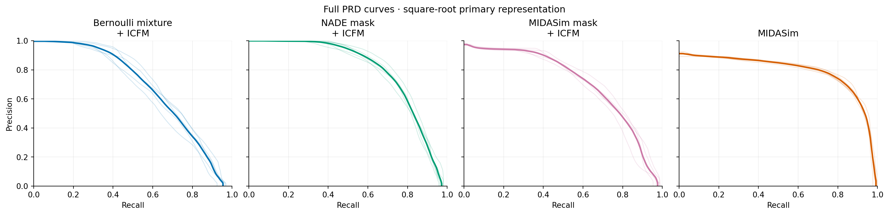
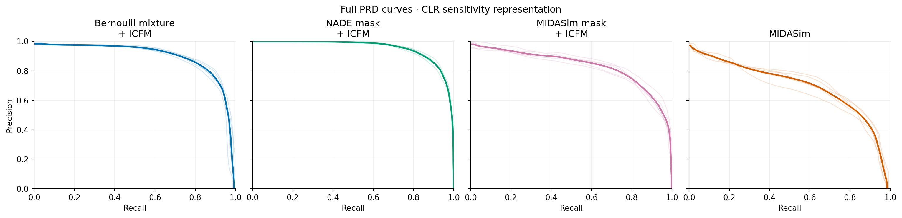

# AGP: a four-generator case study of local representation

The case study compares Bernoulli-mixture-mask + ICFM, NADE-mask + ICFM, MIDASim-mask + ICFM and full MIDASim with equal emphasis. The question is which observed microbial communities each generator underrepresents or overrepresents, and whether the same real observations receive different fitted RDRs across generators. The opening comparison is unchanged. All later analyses reuse the existing generators and separately selected RDRs; no generator or RDR was refitted.

## The selected RDR comparison

| Generator | Selected loss / slope | RDR source AUC | Balanced Brier | Local absolute gap |
| --- | --- | --- | --- | --- |
| Bernoulli mixture + ICFM | JS / 0.5 | 0.901260 ± 0.003411 | 0.135704 ± 0.004999 | 0.171851 ± 0.022541 |
| NADE mask + ICFM | Chi-square / 0.5 | 0.733439 ± 0.009327 | 0.212498 ± 0.002627 | 0.125973 ± 0.024450 |
| MIDASim mask + ICFM | JS / 0.5 | 0.883599 ± 0.005004 | 0.141706 ± 0.003077 | 0.133539 ± 0.017023 |
| MIDASim | JS / 0.5 | 0.946437 ± 0.001892 | 0.095237 ± 0.003138 | 0.121654 ± 0.030269 |

Values are mean ± sample SD over five initializations on the same data. The numerical source table [comparison.csv](comparison.csv) and the opening figure are copied byte-for-byte from the retained comparison, with their recorded SHA-256 hashes verified. Source AUC and Brier measure this evaluator's source discrimination; neither is a generator-quality score. Local gap measures empirical calibration in fixed score cells, not distributional equality or pointwise accuracy.

Each column is one generator. Top: fitted observation-level RDR distributions for real P and generated Q. Bottom: mean fitted RDR against empirical RDR in 20 fixed score cells. Fit 0 is emphasized; four other fits are faint. Dark C.1 and light C.2 intervals are nominal cell-average diagnostics; they do not give confidence intervals for individual true density ratios. All final fits have supported mass one. These retrospective calibration diagnostics use the same assessment observations for empirical frequencies and neural-score means.

## What information RDR adds

For generator $Q_m$, the population target is $r_m(x)=2p(x)/(p(x)+q_m(x))$. Values above one indicate local underrepresentation by $Q_m$; values below one indicate local overrepresentation. Its fitted version supplies a signed score for each observation, enabling a comparison of the same real observation across generators. These directions are interpretations of an estimate, conditional on evaluator quality, not verified individual density ratios.

The reported scalar Gaussian Fréchet distance and Inception Score, or an unlabeled global precision–recall curve, do not name the biological locations of mismatch. The additional deliverable here is a shared, interpretable map that attaches signed representation differences and source mass to communities, plus a paired map of fitted scores on common real samples. This is a claim about the information in the reported outputs, not an exclusive mathematical capability: the histograms underlying PRD, local precision/recall, or other regional metrics can also localize mismatch when their regions are retained and interpreted. Indeed the empirical community ratios below are directly computable from region counts; RDR contributes to discovering the common partition and to scoring individual observations.

[FID](https://papers.neurips.cc/paper/7240-gans-trained-by-a-two-time-scale-update-rule-converge-to-a-local-nash-equilibrium.pdf) compares Gaussian feature summaries; the [original Inception Score](https://arxiv.org/html/1606.03498v1) uses a pretrained sample-class predictor on generated samples; [PRD](https://papers.neurips.cc/paper/7769-assessing-generative-models-via-precision-and-recall.pdf) describes global precision–recall tradeoffs. AGP has no justified Inception classifier here, so **no numerical IS is reported**. Our distance is a Gaussian Fréchet analogue in declared compositional features, not image Inception FID. Related work also defines [individual realism scores](https://arxiv.org/abs/1904.06991), so samplewise quality information is not unique to RDR in the broader literature.

## Global baselines for all four generators

| Generator | Square-root FD | Square-root PRD max F1 | CLR FD | CLR PRD max F1 |
| --- | --- | --- | --- | --- |
| Bernoulli mixture + ICFM | 0.08194 | 0.6311 ± 0.0248 | 189.63 | 0.8341 ± 0.0141 |
| NADE mask + ICFM | 0.06637 | 0.7389 ± 0.0181 | 142.31 | 0.8790 ± 0.0100 |
| MIDASim mask + ICFM | 0.06976 | 0.6698 ± 0.0193 | 178.02 | 0.7748 ± 0.0142 |
| MIDASim | 0.04808 | 0.7700 ± 0.0113 | 217.16 | 0.6766 ± 0.0263 |

Square-root composition is primary; CLR with pseudocount 1e-6 is a representation sensitivity analysis. Each pair-specific PRD quantizer has 64 clusters and was fitted to balanced development-only subsets of 2,048 P and 2,048 Q observations, using five prespecified seeds. All quantizers were frozen before assessment arrays were read by this extension. FD uses all assessment rows and unbiased sample covariances. FD is identical across quantizer seeds; PRD SD describes quantizer initialization/subsampling variation on the fixed cohort, not sampling uncertainty. Scales differ between representations, so their distances should not be compared directly.

Full curves retain every one of the 201 prespecified angle points. Five curves are faint and their anglewise mean is emphasized. Maximum F1 is only a supplemental scalar summary. These are distribution PRD curves, not the classification precision–recall curve of the RDR network. The [raw curves](global/prd_curves.csv) and [cluster counts](global/prd_histograms.csv) remain available.

## A common map of real communities

A single multioutput tree summarizes all four frozen five-fit mean RDRs using the original 1,281 real RDR stopping observations. A fixed subject-disjoint 70%/30% split (seed 2026101302) gives 910 observations to fit the tree and 371 to select its depth. These observations were excluded from RDR gradient updates but participated in RDR checkpoint choice; they are not a new independent teacher-validation cohort. The tree uses 105 interpretable composition summaries (richness, entropy, dominant abundance, taxonomic groups defined from the original 9,162 real training observations, and log balances). Depths 2, 3 and 4 were compared by average squared error across all four targets on the tree-validation subset. Depth 4 with 8 leaves was selected; all rules and leaf order were frozen before this extension read assessment compositions or scores. Every leaf is shown, in increasing leaf-index order, without assessment-based filtering or reordering.

For each fixed community $C$, the empirical regional target is $\hat\theta_m(C)=2\hat P(C)/(\hat P(C)+\hat Q_m(C))$. The corresponding fitted mean uses equal-source mixture weights: $(n_P^{-1}\sum_{i\in P\cap C}\hat r_m(x_i)+n_Q^{-1}\sum_{j\in Q_m\cap C}\hat r_m(x_j))/(\hat P(C)+\hat Q_m(C))$. The formula matters because source sample sizes differ. The left heatmap measures empirical community occupancy; the right summarizes the fitted RDR. Agreement between them must be checked rather than assumed.

Blue values above one indicate a Q deficit; orange values below one indicate a Q excess. Both panels use the same scale, all four methods and every frozen community. Labels include P fraction and P count. A community value is a regional average, not a constant individual RDR throughout that region.

| Community | Real P fraction (n) | Bernoulli mixture + ICFM Q fraction (n) | NADE mask + ICFM Q fraction (n) | MIDASim mask + ICFM Q fraction (n) | MIDASim Q fraction (n) |
| --- | --- | --- | --- | --- | --- |
| C01 | 6.49% (130) | 1.20% (25) | 1.01% (21) | 0.72% (15) | 5.98% (125) |
| C02 | 3.15% (63) | 6.56% (137) | 1.87% (39) | 1.34% (28) | 1.01% (21) |
| C03 | 9.59% (192) | 5.22% (109) | 5.60% (117) | 7.61% (159) | 11.15% (233) |
| C04 | 6.74% (135) | 3.93% (82) | 5.17% (108) | 3.30% (69) | 6.27% (131) |
| C05 | 8.24% (165) | 2.63% (55) | 6.22% (130) | 4.64% (97) | 8.62% (180) |
| C06 | 12.74% (255) | 10.82% (226) | 12.88% (269) | 10.63% (222) | 14.22% (297) |
| C07 | 11.99% (240) | 10.05% (210) | 11.92% (249) | 14.50% (303) | 15.56% (325) |
| C08 | 41.06% (822) | 59.60% (1245) | 55.34% (1156) | 57.25% (1196) | 37.19% (777) |

The following rules define the shared regions. `log mass/rest` is the log of group mass plus 1e-6 divided by complementary mass plus 1e-6; `log balance` compares two group masses with the same pseudocount. Rules are reproducible mathematical descriptions, not clinical labels or established microbial community classes.

| Community | Frozen rule |
| --- | --- |
| C01 | Lachnospiraceae log mass/rest <= -3.2167 AND Streptococcaceae log mass/rest <= -2.73 |
| C02 | Lachnospiraceae log mass/rest <= -3.2167 AND Streptococcaceae log mass/rest > -2.73 |
| C03 | Lachnospiraceae log mass/rest > -3.2167 AND Porphyromonadaceae log mass/rest <= -5.40137 AND Rikenellaceae/Enterobacteriaceae log balance <= 0.824037 |
| C04 | Lachnospiraceae log mass/rest > -3.2167 AND Porphyromonadaceae log mass/rest <= -5.40137 AND Rikenellaceae/Enterobacteriaceae log balance > 0.824037 |
| C05 | Lachnospiraceae log mass/rest > -3.2167 AND Porphyromonadaceae log mass/rest > -5.40137 AND Lachnospiraceae log mass/rest <= -2.1706 AND Enterobacteriaceae/Bacteroidaceae log balance <= -4.32268 |
| C06 | Lachnospiraceae log mass/rest > -3.2167 AND Porphyromonadaceae log mass/rest > -5.40137 AND Lachnospiraceae log mass/rest <= -2.1706 AND Enterobacteriaceae/Bacteroidaceae log balance > -4.32268 |
| C07 | Lachnospiraceae log mass/rest > -3.2167 AND Porphyromonadaceae log mass/rest > -5.40137 AND Lachnospiraceae log mass/rest > -2.1706 AND Ruminococcaceae log mass/rest <= -1.73639 |
| C08 | Lachnospiraceae log mass/rest > -3.2167 AND Porphyromonadaceae log mass/rest > -5.40137 AND Lachnospiraceae log mass/rest > -2.1706 AND Ruminococcaceae log mass/rest > -1.73639 |

Three descriptive comparisons make the common-region information concrete. **C01**, low Lachnospiraceae and low Streptococcaceae (approximately at most 3.85% and 6.12% mass respectively), contains 6.49% of real observations. The three ICFM methods assign it only 1.20%, 1.01% and 0.72% of generated mass, whereas full MIDASim assigns 5.98%. Its empirical regional RDRs are 1.689, 1.732, 1.801 and 1.041 in the four-generator order. Thus the near-matched full-MIDASim regional frequency differs from the shared deficit in the three ICFM methods, without implying that samples within this region match in distribution.

**C02**, low Lachnospiraceae and higher Streptococcaceae, contains 3.15% of real observations. The Bernoulli mixture places 6.56% of its samples there, while NADE, MIDASim-mask + ICFM and full MIDASim place 1.87%, 1.34% and 1.01%. The same community therefore has an empirical excess for the mixture and empirical deficits for the other three: regional RDRs 0.649, 1.255, 1.403 and 1.516. Fitted regional means have the same directions (0.887, 1.402, 1.567 and 1.501), but the mixture's absolute gap is 0.239. The hybrid and full MIDASim have only 28 and 21 generated observations in this community; the low counts remain explicit.

**C08** contains 41.06% of real observations and, under its full rule above, has larger Lachnospiraceae and Ruminococcaceae masses. The three ICFM methods allocate 59.60%, 55.34% and 57.25% there, versus full MIDASim's 37.19%; empirical regional RDRs are 0.816, 0.852, 0.835 and 1.049. All eight communities, including those with smaller contrasts, remain visible. These examples describe estimated regional frequencies, not causal family effects or statistically significant direction changes.

The extrema below are descriptive summaries across all displayed leaves, not hypothesis tests or independently selected biological discoveries:

| Generator | Lowest empirical regional RDR | Highest empirical regional RDR | Largest absolute fitted–empirical gap |
| --- | --- | --- | --- |
| Bernoulli mixture + ICFM | C02: 0.649 | C01: 1.689 | 0.239 |
| NADE mask + ICFM | C08: 0.852 | C01: 1.732 | 0.147 |
| MIDASim mask + ICFM | C08: 0.835 | C01: 1.801 | 0.165 |
| MIDASim | C07: 0.870 | C02: 1.516 | 0.076 |

There are 5 generator–community cells with fewer than 30 observations from at least one source. All are retained and flagged in [shared_communities.csv](communities/shared_communities.csv), which includes P/Q counts and fractions, balanced mass, empirical RDR, fitted means, five-fit SD and absolute gaps. No new regional confidence intervals or multiple-testing claims are made. The partition was learned from P only: it describes real communities and does not discover modes supported exclusively by generated Q.

The small tree is an interpretable summary of the neural score, not the neural evaluator itself. Its fidelity on real assessment samples is:

| Generator | Tree mean squared error | Tree R² |
| --- | --- | --- |
| Bernoulli mixture + ICFM | 0.2128 | 0.034 |
| NADE mask + ICFM | 0.1966 | 0.121 |
| MIDASim mask + ICFM | 0.2132 | 0.024 |
| MIDASim | 0.1876 | -0.027 |

Low or negative R² means the interpretable partition captures little of that evaluator's samplewise variation. Large fitted–empirical regional gaps mean that fitted RDR magnitudes should not be used as reliable community mass estimates; report empirical occupancies alongside them. The same source observations contribute to both quantities, so this comparison is descriptive, not an independent validation of oracle RDR recovery.

## The same real observations across generators

Each panel compares the five-fit mean predictions for the same 2,002 real assessment observations. Hexagons contain counts, with no sample labels exported. The dashed diagonal marks equal fitted scores; dotted lines mark one. Off-diagonal points and rank disagreement show that fitted RDR can assign generator-specific scores to the same real observation. Opposite sides of one are opposite fitted directions only; they do not establish true local underrepresentation versus overrepresentation.

| Generator A | Generator B | Spearman | Mean absolute score difference | Opposite fitted directions |
| --- | --- | --- | --- | --- |
| Bernoulli mixture + ICFM | NADE mask + ICFM | 0.375 | 0.573 | 33.62% |
| Bernoulli mixture + ICFM | MIDASim mask + ICFM | 0.530 | 0.338 | 16.68% |
| Bernoulli mixture + ICFM | MIDASim | 0.155 | 0.398 | 17.23% |
| NADE mask + ICFM | MIDASim mask + ICFM | 0.400 | 0.526 | 33.02% |
| NADE mask + ICFM | MIDASim | 0.119 | 0.668 | 35.66% |
| MIDASim mask + ICFM | MIDASim | 0.500 | 0.320 | 13.64% |

The [paired summary](communities/paired_real_scores.csv) covers all six pairs, with no favorable pair selected for display. These 2,002 rows form one cohort; the 20 reused RDR fits are four sets of five initializations, not independent samples of biological populations.

## Scope, limitations and reproducibility

The case study is retrospective: the assessment cohort had been examined in earlier analyses. New tree and quantizer choices were frozen before this extension's assessment, but that does not turn the existing cohort into a new confirmatory sample. Real subjects are disjoint between development and assessment; generator training overlaps real evaluator training/stopping. Each comparison uses 2,002 real and 2,089 generated assessment observations on 614 taxa. Resampled observed masks are excluded by the prior paper-scope decision, with their original records preserved elsewhere.

A preparation-only tree trained on in-fit RDR training predictions showed negative stopping R² for three methods. Before any shared-community assessment, its development design was revised to use the subject-disjoint inner split of original RDR stopping observations described above. That initial preparation is preserved separately in the private staging area, and the final freeze records this revision. No assessment-guided tree revision followed.

Evaluator dependence remains substantial. In the unchanged conventional comparison, NADE's boosted-tree composition AUC is 0.9896 while its neural RDR source AUC is 0.7334. Thus the neural comparison does not establish NADE fidelity or an ordering that is invariant to evaluator choice. The two MIDASim-mask methods share the assessed occurrence masks by construction; differences in their local representations compare their abundance-generating mechanisms conditional on that common mask design. This is not a causal decomposition of the networks' learned features.

The opening table/figure and reused conventional summaries are unchanged. All 20 assessment score replays match the stored predictions exactly. The new public package exports aggregate tables, figures, rules and source snapshots only: no subject IDs, sample IDs, row-level score tables, abundance arrays or fitted checkpoints. Individual score coordinates are summarized in a hexagonal count image, with no vector point layer. Source and input hashes, completion gates, counts and output hashes are recorded in [manifest.json](manifest.json). Independent package audit is a separate step; rendering completion alone does not certify that audit.

The primary paper sequence is the unchanged four-generator RDR table/figure, global baseline context, the common community map with occupancy evidence, and the common-real paired fitted-score figure. Controlled perturbation is not the central evidence in this AGP study. The supported contribution is interpretable, signed, generator-specific diagnostic information beyond the listed global summaries, with calibration and evaluator limitations visible alongside it.
